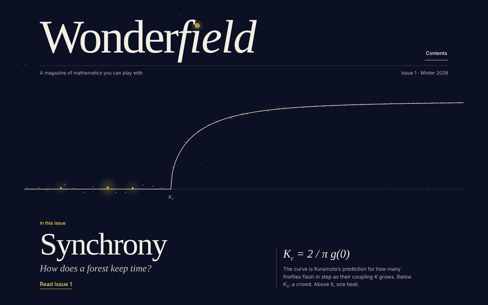
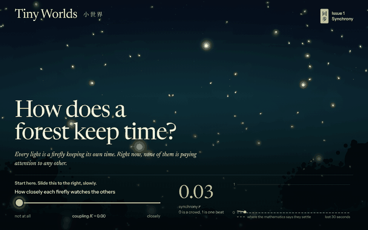
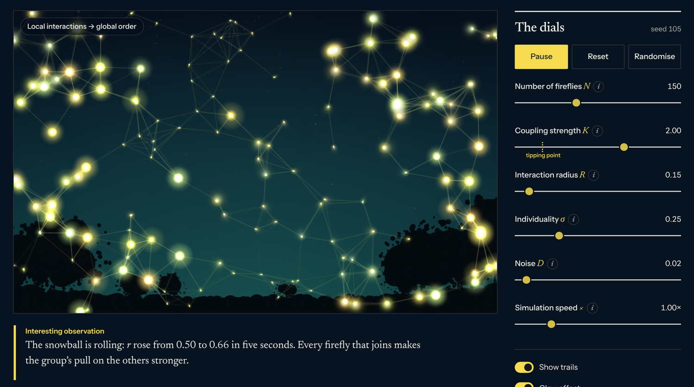
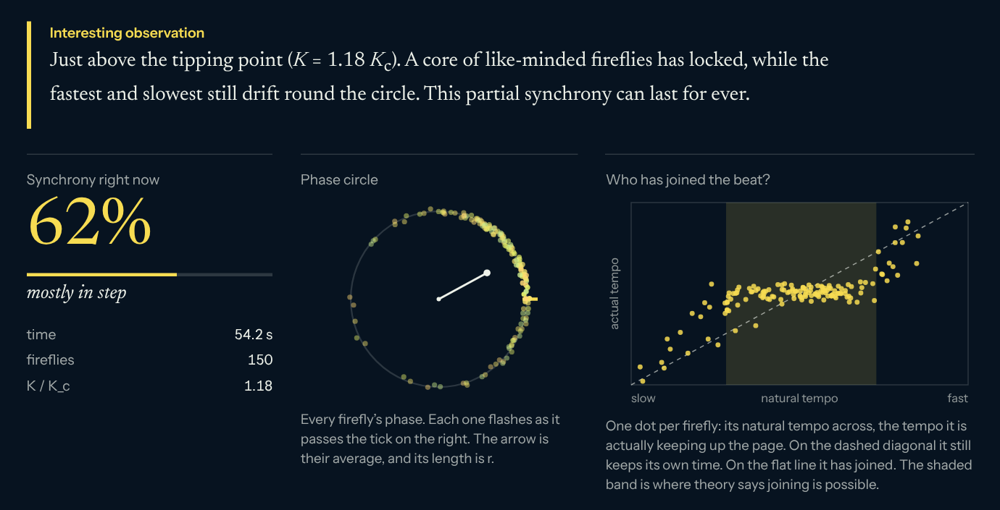
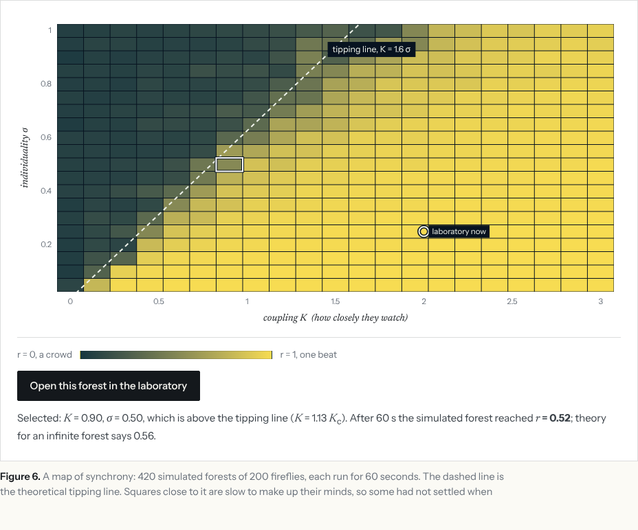
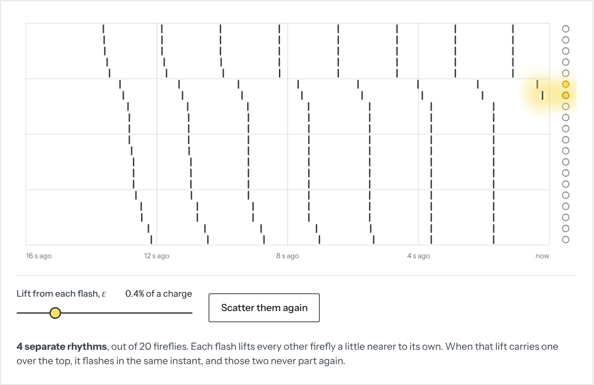

# Wonderfield

**A magazine of mathematics you can play with.**

**[Read it online → yunmo0121.github.io/wonderfield](https://yunmo0121.github.io/wonderfield/)**



Each issue takes one phenomenon, opens with one experiment you can play with, and then
shows the mathematics behind it, from the first idea to the research literature. Every
model is written down, every dial is a symbol in it, and every number quoted was
measured by simulation and checked by tests.

The name is a pun. A *field* is where fireflies come out at night, and where naturalists
go to watch them. In algebra it is a set of numbers you can add, subtract, multiply and
divide (except by zero). In physics it is a quantity spread through space. And in
Issue 1, every firefly answers to the *mean field* of all the others.

## Issue 1 · Synchrony

*How does a forest keep time?* Thousands of fireflies can flash in unison with
nobody leading. Right after the cover comes a night forest and a single dial: how closely each
firefly watches the others. Slide it up and a beat appears out of nowhere, while
a curve under the sky tracks the synchrony `r` against what the theory predicts.



| Colour | Phenomenon | Experiment |
|---|---|---|
| Firefly yellow on a June night | Synchrony: many rhythms becoming one | The listening dial |

## What is inside

The feature, *The clocks in the trees*, builds the idea in three parts. Each
part has a figure to play with and a note called **The mathematics** that can be
opened by itself, or all at once with the *Story / + Mathematics* switch.

| | What you do | The mathematics behind it |
|---|---|---|
| **Part one · The rhythm of one firefly** (Fig. 1) | Drag a dot round a circle and watch it unroll into a wave | Phase, frequency, period; sin and cos as coordinates on the unit circle |
| **Part two · When fireflies interact** (Fig. 2, 3) | Referee two fireflies, then run a sky of 150 | Adler's equation dφ/dt = Δω − K sin φ, the locking condition \|Δω\| ≤ K, a saddle-node bifurcation; the local Kuramoto model with noise |
| **Part three · Measuring collective order** (Fig. 4) | Add arrows head to tail | Euler's formula, the order parameter r e^{iψ}, and why random phases never give r = 0 |
| **Why it works** | Watch “Who has joined the beat?” in the laboratory | The mean-field form dθᵢ/dt = ωᵢ + K r sin(ψ − θᵢ): agreement feeds itself; a firefly can lock when \|ωᵢ − Ω\| ≤ K r |
| **When it fails** (Fig. 5, 6) | Run 30 simulations against the theory curve; explore a map of 420 simulated forests | Kuramoto's self-consistency equation, the tipping point K_c = σ√(8/π), and how noise raises it (Sakaguchi's formula) |
| **What the model leaves out** (Fig. 7) | Watch twenty fireflies that talk only in flashes merge into one rhythm | The pulse-coupled model of Mirollo and Strogatz: charging curves and absorption; then fireflies that retune, bursts, lines of sight |

Then: *The same story elsewhere* (Huygens's clocks, the heart, the Millennium
Bridge, applause, the power grid) and *Seven experiments to try*, each with a
fixed seed and a measured answer.



### The laboratory

- Six dials: number of fireflies N, coupling K, interaction radius R,
  individuality σ, noise D, simulation speed, each with an explanation
- Start / pause, reset (same seed), randomise (new seed); click the sky to add fireflies
- Trails, glow and neighbour connections can be switched on and off
- Live read-outs: synchrony in per cent, a phase circle, r over the last 40 seconds, K / K_c
- **Who has joined the beat?** Every firefly's natural tempo against the tempo it is
  actually keeping: locked fireflies fall onto a flat line, and the shaded band is the
  theoretical locking range \|ω − Ω\| ≤ K r
- A dotted tick on the coupling dial marks the tipping point for the current
  individuality and noise
- **Interesting observation:** a sentence under the sky that says what is
  happening and why (rules in `src/worlds/firefly/observations.js`, unit-tested)
- A badge for the mode: *Local interactions → global order*
- Save the sky as a picture (on the published site)



### Reading it your way

- **Story / + Mathematics** opens or closes every mathematical note
- **Paper / Night** switches the reading pages between white paper and a night edition
- Both choices are remembered on your device

## The model

A local Kuramoto model with phase noise, on a world whose edges wrap round:

$$d\theta_i = \Big[\omega_i + \frac{K}{|N_i|}\sum_{j\in N_i}\sin(\theta_j-\theta_i)\Big]dt + \sqrt{2D}\,dW_i, \qquad r\,e^{i\psi} = \frac1N\sum_j e^{i\theta_j}$$

Derivations, numerics and limits are in [`docs/firefly-model.md`](docs/firefly-model.md).

## Measured, not estimated

`npm run experiments`: 5 seeds × 90 s of simulated time, N = 150, r averaged over the last 30 s.

| Experiment | K | R | σ | D | K / K_c | mean r | time to r > 0.8 |
|---|---|---|---|---|---|---|---|
| Everyone ignores everyone | 0 | 0.35 | 0.25 | 0.02 | 0.00 | 0.07 ± 0.00 | never |
| Below the threshold | 0.2 | everyone | 0.25 | 0.02 | 0.47 | 0.12 ± 0.01 | never |
| On the edge | 0.5 | everyone | 0.25 | 0.02 | 1.18 | 0.65 ± 0.09 | never |
| Above the threshold | 0.8 | everyone | 0.25 | 0.02 | 1.88 | 0.92 ± 0.01 | 10.2 s |
| Neighbourhood gossip | 2 | 0.15 | 0.25 | 0.02 | 4.71 | 0.79 ± 0.08 | 27.9 s |
| A windy night | 0.8 | 0.35 | 0.25 | 0.4 | 0.79 | 0.16 ± 0.04 | never |
| Identical twins | 0.3 | everyone | 0 | 0 | ∞ | 1.00 ± 0.00 | 19.6 s |

K_c is the tipping point for a forest where everyone sees everyone, for that row's σ
*and* its noise D: 0.43 for the default dials, and 1.01 on the windy night, which is why
that night never synchronises.

`npm run map` rebuilds Figure 6: 420 simulations (N = 200, 60 s each) over K and σ.





## Engineering

- **Simulation and drawing are separate.** `simulation.js` has no DOM code and runs in Node.
- **Reproducible.** Seeded random numbers (mulberry32): same seed and dials, same night.
- **Frame-rate independent.** Fixed time step of 1/60 s, Euler–Maruyama integration.
- **Tested.** 38 unit tests (`npm test`): the integrator, the order parameter, speed and
  frame-rate invariance, the theory curve, the noisy tipping point against simulation,
  the pulse-coupled model, the observation rules and the precomputed map.
- **Self-contained.** Fonts are bundled, so the site needs no third-party requests.

## Run it

```bash
npm install
npm run dev          # http://localhost:5173
npm test             # unit tests (Vitest)
npm run experiments  # re-measure the experiment table
npm run map          # rebuild the Figure 6 data
npm run build        # production build in dist/
```

`.github/workflows/deploy.yml` publishes to GitHub Pages on every push to `main`
(one-time setup: *Settings → Pages → Source: GitHub Actions*).

## Project structure

```
index.html                     the front page: wordmark, cover illustration, the issues
synchrony/index.html           Issue 1: listening dial, feature, laboratory, experiments, colophon
src/
├── home.js                    the front page
├── main.js                    Issue 1: wires everything together
├── style.css                  paper and night editions
├── worlds/firefly/
│   ├── simulation.js          the model (no drawing)
│   ├── firefly.js             one firefly: position, heading, phase, brightness
│   ├── fireflyWorld.js        animation loop, night sky and trees, rendering
│   ├── observations.js        "Interesting observation" rules
│   └── parameters.js          every tunable number in one place
├── worlds/pulse/
│   └── pulseSwarm.js          fireflies that talk only in flashes (Mirollo–Strogatz), event-driven
├── figures/                   oneClock · twoClocks · vectorSum · phaseTransition · syncMap · pulseFireflies · figureKit
├── ui/
│   ├── frontCurve.js          the front cover: the tipping-point curve and its fireflies
│   ├── wordmark.js            the Wonderfield wordmark
│   ├── menu.js                the Contents menu
│   ├── coverExperiment.js     the listening dial and its curve
│   ├── chrome.js              reading-mode and edition switches, the phase-ring emblem
│   ├── controlsPanel.js       the laboratory's dials
│   ├── infoPanel.js           synchrony, phase circle, who has joined, r(t), observation box
│   └── layout.js              KaTeX typesetting, the experiments page
├── utils/                     math.js · random.js · theme.js · helpers.js
└── data/                      issues.js (the shelf) · experimentNotes.js · syncMap.js (generated)
tests/                         simulation.test.js · observations.test.js · pulse.test.js
scripts/                       run-experiments.mjs · build-sync-map.mjs
docs/                          firefly-model.md · design-notes.md · roadmap.md · media/
```

## Adding an issue

1. Add an entry to `src/data/issues.js` (colour, question, phenomenon, experiment) and
   set its `status` to `'open'` with an `href` when it is ready.
2. Create its folder with an `index.html`, like `synchrony/`.
3. Add that page to `build.rollupOptions.input` in `vite.config.js`.

The front page shelf and every Contents menu update themselves from `issues.js`.

## On the shelf

| No. | Issue | The question | Status |
|---|---|---|---|
| 1 | **Synchrony** | How does a forest keep time? | Out now |
| 2 | **Flocks** | How does a murmuration turn as one? | In preparation |
| 3 | **Life** | Can four rules make something alive? | Planned |

**Field notes**, the working notebook behind every issue (full derivations, experiment
logs, parameter comparisons, algorithms drawn step by step), will grow alongside them.

See [`docs/roadmap.md`](docs/roadmap.md).

## Sources

Kuramoto (1975) · Strogatz, *Physica D* (2000) · Acebrón et al., *Rev. Mod. Phys.* (2005) ·
Adler, *Proc. IRE* (1946) · Sakaguchi, *Prog. Theor. Phys.* (1988) · Strogatz & Mirollo, *J. Stat. Phys.* (1991) ·
Peskin (1975) · Mirollo & Strogatz, *SIAM J. Appl. Math.* (1990) ·
Buck, *Q. Rev. Biol.* (1988) · Ermentrout, *J. Math. Biol.* (1991) ·
Sarfati et al., *eLife* (2023) · Belykh et al., *Nature Communications* (2021) ·
Néda et al., *Nature* (2000). Full list in the issue's colophon.

---

Written and built by Kristie · Feedback and ideas are very welcome: open an [issue](https://github.com/Yunmo0121/wonderfield/issues).
